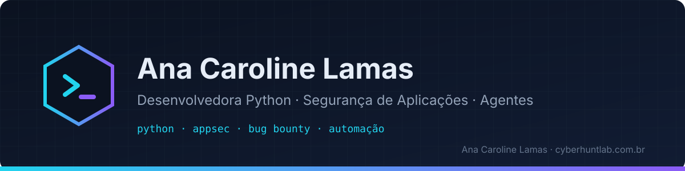
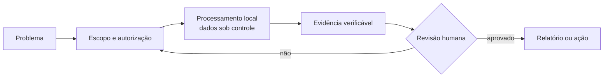

# Ana Caroline Lamas

**Desenvolvedora Python · Arquitetura de soluções · Segurança de aplicações · IA local**
Nova Lima, MG – Brasil

---

Parto de um problema e desenho a solução inteira: de onde vêm os dados, o que pode dar errado, quem decide o quê e como provar que funciona. Depois implemento em Python, no terminal, e publico.

Fui administradora do **Google Summer of Code 2026** pela organização open source **BRL-CAD**, cuidando de prazos, avaliações e suporte aos contribuidores.

## Como eu desenho uma solução

Os mesmos princípios aparecem em projetos de assuntos muito diferentes:

| Princípio | O que significa na prática | Onde ver |
|---|---|---|
| **Escopo e autorização primeiro** | A ferramenta recusa rodar fora do que foi autorizado e registra cada decisão. | [CWE-Cover-2.0](https://github.com/ticarollamas-arch/CWE-Cover-2.0) · [cyber-hunter-lab-integrated-v2](https://github.com/ticarollamas-arch/cyber-hunter-lab-integrated-v2) |
| **Evidência antes de alarme** | Suspeita, hipótese e achado confirmado são estados diferentes; cada alerta vem com o motivo. | [go-traversal-detector](https://github.com/ticarollamas-arch/go-traversal-detector) · [sentinel_auditoria_vercel_v2](https://github.com/ticarollamas-arch/sentinel_auditoria_vercel_v2) |
| **Dados ficam com o usuário** | Processamento no próprio aparelho ou servidor, sem enviar arquivos a terceiros quando não precisa. | [cortador-916](https://github.com/ticarollamas-arch/cortador-916) |
| **Independência de APIs de terceiros** | APIs próprias, modelos de pesos abertos e adaptadores trocáveis no lugar de dependência de provedor. | [engineering-intelligence-v2](https://github.com/ticarollamas-arch/engineering-intelligence-v2) |
| **Sistema que explica o raciocínio** | Em vez de caixa-preta, a ferramenta mostra por que chegou ao resultado. | [engineering-intelligence-v2](https://github.com/ticarollamas-arch/engineering-intelligence-v2) · [CWE-Cover-2.0](https://github.com/ticarollamas-arch/CWE-Cover-2.0) |
| **Ação com efeito exige uma pessoa** | Testes invasivos, publicações e mudanças de estado só acontecem com aprovação humana. | [cyber-hunter-lab-integrated-v2](https://github.com/ticarollamas-arch/cyber-hunter-lab-integrated-v2) |

## Soluções

Cada projeto responde a um problema específico. As demos abrem a versão publicada.

| Problema | Solução | Decisão de arquitetura | Links |
|---|---|---|---|
| Pesquisar vulnerabilidades sem sair do escopo do programa | Motor de pesquisa com escopo versionado, limite de requisições, aprovação humana para testes ativos e trilha de auditoria | Toda requisição passa por um único cliente HTTP que confere o escopo antes de sair | [código](https://github.com/ticarollamas-arch/cyber-hunter-lab-integrated-v2) · [motor (PR)](https://github.com/ticarollamas-arch/cyber-hunter-lab-integrated-v2/pull/2) |
| Reconhecimento passivo com pouco falso positivo | `cwe_discover.py`: regras declarativas por CWE e agentes de mapeamento, falso positivo e impacto antes do relatório | Exige arquivo de escopo e autorização explícita para rodar | [código](https://github.com/ticarollamas-arch/CWE-Cover-2.0) |
| Encontrar *path traversal* em código Go | Análise estática que verifica se há barreira de contenção antes de apontar o candidato | Indica onde revisar; não gera exploit | [código](https://github.com/ticarollamas-arch/go-traversal-detector) |
| Transformar um pedido vago em especificação técnica | Gerador de prompts que separa intenção, exemplos e restrições e monta requisitos com rastreabilidade | Motor determinístico no navegador; IA só como refinamento opcional | [código](https://github.com/ticarollamas-arch/engineering-intelligence-v2) · [demo](https://engineering-intelligence-v3-1.vercel.app) |
| Cortar vídeos longos em vertical com legenda, sem mandar o vídeo para a nuvem | Cortador 9:16: transcrição, escolha dos melhores trechos e gravação no navegador | O vídeo nunca sai do aparelho; só o áudio vai para transcrição, ou nada, no modo local | [código](https://github.com/ticarollamas-arch/cortador-916) · [demo](https://cortador-916.vercel.app) |
| Ver o que um domínio expõe publicamente sem atacá-lo | Auditoria externa passiva de segredos, backups e consoles expostos | Somente leitura: nenhum payload de exploração e nenhuma tentativa de login | [código](https://github.com/ticarollamas-arch/sentinel_auditoria_vercel_v2) · [demo](https://sentinelauditoriavercelv2.vercel.app) |
| Inspecionar pacotes compactados e compilados com segurança | Engenharia reversa de zip, tar e apk com mapa da arquitetura | Defesas contra ZipSlip e zip bomb antes de qualquer extração | [código](https://github.com/ticarollamas-arch/Engenharia-Reversa) |
| Transformar dados abertos da NASA em informação geoespacial | HACKMIND GeoSentinel | Construído sobre dados abertos | [código](https://github.com/ticarollamas-arch/hackmind-geosentinel) · [demo](https://hackmind-geosentinel.vercel.app) |
| Mostrar todos os projetos em um só lugar | Bancada de projetos, cada um em `/nome-do-projeto` | Uma página de entrada que leva a cada projeto | [código](https://github.com/ticarollamas-arch/bancada-cyberhuntlab--1-) · [demo](https://bancada-cyberhuntlab-1.vercel.app) |

## Ferramentas

Python · Go (leitura e análise) · TypeScript · Docker · GitHub Actions · Google Cloud · Vercel · LLMs, modelos de pesos abertos e orquestração de agentes · OWASP Top 10 · CWE/CVE/CVSS · análise estática e *taint analysis*

## Certificações e formação

**Segurança**
- Cibersegurança do Zero à Prática — Santander / DIO
- GenAI, Dados & Cyber — Bradesco / DIO
- Gestão de Identidades com Boas Práticas de Segurança — DIO

**Cloud**
- Fundamentos Essenciais da Infraestrutura AWS — DIO
- Gestão de Recursos na Google Cloud Platform — DIO
- Deploy e Build de Agentes em Produção; AI Boost Bites (Gemini) — Google Cloud Skills Boost

**Programação**
- Formação Java (10h+): POO, estruturas de dados, Streams (17h), Maven, testes, debugging, exceções e I/O — DIO
- Formação Python: POO, estruturas de dados, strings, coleções, data/hora e boas práticas — DIO
- Formação GitHub Certification (10h): administração, Projects, colaboração e Markdown — DIO
- Data Analysis with Python — freeCodeCamp

**IA e agentes**
- CrewAI: conceitos, ecossistema e estrutura de projetos — DIO
- Fundamentos da IA e Pensamento Crítico — DIO
- Trilhas de desenvolvimento e segurança — Santander, Google e Anthropic
